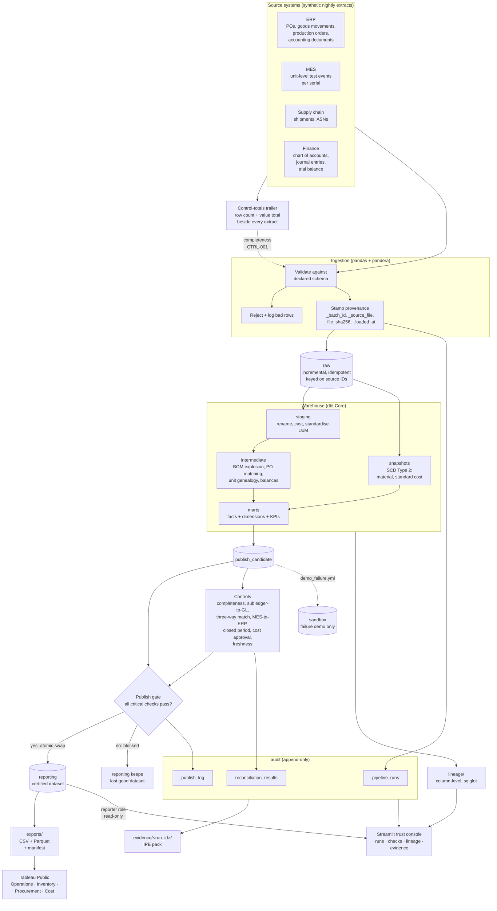

# Architecture

> All data is synthetic and all controls are simulated, SOX-style controls.
> This project does not claim SOX compliance ([ADR-019](DECISIONS.md#adr-019-label-all-data-synthetic-and-all-controls-simulated)).

## The shape of it

## Why the pieces are arranged this way

**Nothing reaches `reporting` unvalidated.** Models build into
`publish_candidate`, the critical checks run against that candidate, and only a
passing build is swapped into `reporting`
([ADR-014](DECISIONS.md#adr-014-publish-by-swapping-a-validated-build-into-reporting)).
A failed run therefore leaves a complete, previously validated dataset in place
rather than a half-loaded one. Leaders see a stale number with an honest
timestamp instead of a wrong number with a current one.

**Every number carries its provenance.** Each landed row keeps `_batch_id`,
`_source_file`, `_file_sha256`, and `_loaded_at`, and those columns survive into
the marts. So a figure on a dashboard can be joined back to the exact file, with
its checksum, and the git commit of the code that processed it
([ADR-008](DECISIONS.md#adr-008-append-only-audit-table-for-every-pipeline-run)).

**The audit trail cannot be edited.** `UPDATE` and `DELETE` are revoked on
`audit.pipeline_runs` for every role, and a trigger raises on any attempt — two
layers, so a bypass leaves an error rather than a silent change.

**Reads are least-privilege.** The trust console connects as `reporter`, which
can read `reporting` and nothing else. It is physically unable to see `raw`,
`sandbox`, or a half-built candidate.

**The failure demo cannot touch the live data.** `demo_failure.yml` pins its
target schema to `sandbox` and refuses to start otherwise.

## Schemas

| Schema | Holds | Written by | Read by |
| --- | --- | --- | --- |
| `raw` | Landed extracts with provenance, no business logic | `loader` | `transformer` |
| `staging` | Renamed, cast, unit-standardised; no joins | `transformer` | `transformer` |
| `intermediate` | Business logic: BOM explosion, matching, genealogy, balances | `transformer` | `transformer` |
| `marts` | Facts, dimensions, KPI models | `transformer` | `transformer` |
| `publish_candidate` | A complete build awaiting the gate | `transformer` | controls |
| `reporting` | The certified dataset | gate only | `reporter` |
| `sandbox` | Failure demos and risky changes | `transformer` | nobody live |
| `audit` | Append-only run log, check results, publish log | `INSERT` only | `auditor` |
| `evidence` | Generated IPE packs | controls | `auditor` |

## Roles

| Role | Can | Cannot |
| --- | --- | --- |
| `loader` | Write `raw`; `INSERT` on `audit` | Read `reporting`; modify `audit` history |
| `transformer` | Read `raw`; write the build schemas and `reporting` | Modify `audit` history |
| `reporter` | Read `reporting` | See `raw`, `sandbox`, or candidates |
| `auditor` | Read `audit` and `evidence` | See business data |

Defined in [`warehouse/sql/roles.sql`](../warehouse/sql/roles.sql). Phase 1
tests assert both the permitted and the denied actions for each role.

## End-to-end lineage path

The project's claim is that any dashboard number traces to the source columns
that produced it. The path has four links, and each is resolved by a different
mechanism:

| Link | Resolved by | Phase |
| --- | --- | --- |
| Source file → raw table | `audit.pipeline_runs` (file hash, batch ID, row counts) | 1 |
| Raw column → mart column | sqlglot over dbt's compiled SQL | 5 |
| Mart column → reporting column | The publish gate's schema swap, which renames rather than transforms | 1 |
| Reporting column → dashboard field | Documented per certified KPI, driven by `meta: {certified: true}` tags | 5 |

A CI test fails when a certified KPI cannot be resolved all the way to raw
source columns, so the chain cannot break silently
([ADR-009](DECISIONS.md#adr-009-sqlglot-for-column-level-lineage), CTRL-017).

*Phase 5 (BTB-59) fills in the worked example that walks one KPI through all
four links.*

## Hosting

| Component | Host | Constraint that shaped the design |
| --- | --- | --- |
| Warehouse | Neon (free) | 1 GB per project; suspends after 5 min idle. Hence the small `demo` profile. |
| Trust console | Streamlit Community Cloud (free) | Sleeps after 12 h without traffic; ~1 GB memory. |
| BI dashboard | Tableau Public (free) | No automated refresh for file extracts; everything is public. |
| dbt docs | GitHub Pages (free) | 1 GB site; build-rate limit avoided by deploying from Actions. |

Limits were checked on 2026-11-02 and recorded in
[ADR-015](DECISIONS.md#adr-015-free-tier-hosting-for-the-live-demo). Providers
change them, so re-verify before relying on them.

## Running it

| Target | Does |
| --- | --- |
| `make init` | Start Postgres, create schemas and roles |
| `make data` | Generate synthetic extracts + control totals |
| `make load` | Validate and incrementally load into `raw` |
| `make build` | dbt build into `publish_candidate` |
| `make controls` | Run reconciliations, record results |
| `make publish` | Swap into `reporting` if every critical check passed |
| `make lineage` | Generate column-level KPI lineage |
| `make export` | Write certified datasets + manifest |
| `make evidence` | Generate an IPE evidence pack |
| `make all` | All of the above, from scratch |

`make help` lists every target with its phase.
